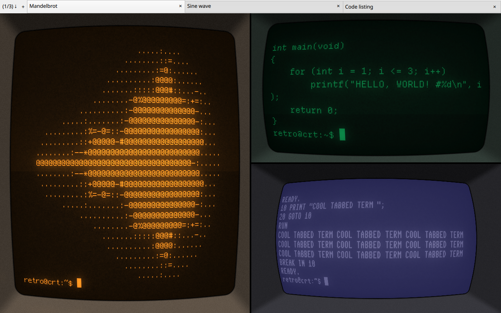
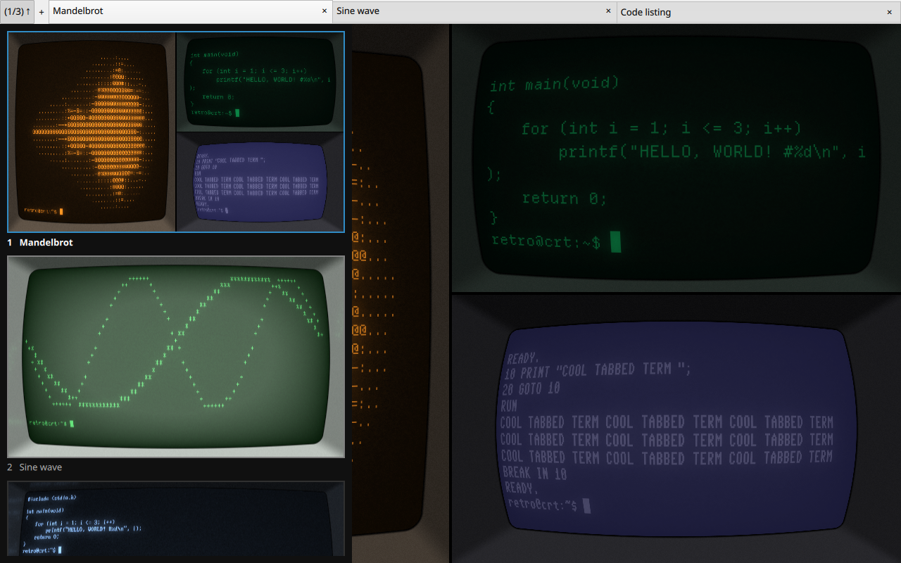

# cool-tabbed-term

**cool-retro-term, now with split terminals, per-terminal profiles and a tab quick view.**



cool-tabbed-term is a fork of [cool-retro-term](https://github.com/Swordfish90/cool-retro-term),
the terminal emulator that mimics the look and feel of old cathode-ray tube screens.
It keeps all of the CRT eye candy and adds the workflow features of tiling terminals
such as Tilix and Terminator.

## What's new in this fork

### Split terminals (tiling)
- Right-click a terminal and choose **Split Vertically** or **Split Horizontally**
  (also in the File menu, or <kbd>Ctrl</kbd>+<kbd>Shift</kbd>+<kbd>E</kbd> / <kbd>Ctrl</kbd>+<kbd>Shift</kbd>+<kbd>O</kbd>).
  The terminal is split in half and a new one opens in the same directory.
- Split as often as you like; every pane is a complete CRT screen with its own curvature and bezel.
- Drag the black divider between panes to resize them. Panes keep their proportions when the window is resized.
- Move between panes with <kbd>Alt</kbd>+arrow keys or a click. While a tab is split, the panes without focus are dimmed.
- Closing a pane (<kbd>Ctrl</kbd>+<kbd>Shift</kbd>+<kbd>W</kbd> or exiting its shell) gives its space to its neighbour.

### Per-terminal profiles
- Every pane, tab and window has its own profile: mix an amber screen, a green one and a Commodore 64 side by side.
- **Profiles** in the right-click menu changes only the terminal you clicked.
- The **Settings** window edits the focused terminal and shows its name in the title.
- New splits, tabs and windows start with the profile of the terminal they were opened from.
- The profile of the last focused terminal is remembered for the next start.

### Tab quick view



- The left end of the tab bar shows **(1/3) ↓ +**: the current tab, the number of tabs, the quick view toggle and a new-tab button.
- The quick view is a strip with a **live** preview of every tab, splits and effects included.
- Click a preview, or use <kbd>↑</kbd>/<kbd>↓</kbd> and <kbd>Enter</kbd>, to switch tabs. <kbd>Esc</kbd> or a click outside closes it.

### Fixes
- No more crash after opening several tabs, or when closing a window.
- Shader compilation works with older Qt versions such as Qt 6.4 (Ubuntu 24.04) and with in-source builds; see [Building](#building).

## Keyboard shortcuts

| Action | Linux | macOS |
|---|---|---|
| Split vertically (side by side) | <kbd>Ctrl</kbd>+<kbd>Shift</kbd>+<kbd>E</kbd> | <kbd>Ctrl</kbd>+<kbd>Shift</kbd>+<kbd>E</kbd> |
| Split horizontally (stacked) | <kbd>Ctrl</kbd>+<kbd>Shift</kbd>+<kbd>O</kbd> | <kbd>Ctrl</kbd>+<kbd>Shift</kbd>+<kbd>O</kbd> |
| Close terminal | <kbd>Ctrl</kbd>+<kbd>Shift</kbd>+<kbd>W</kbd> | <kbd>Ctrl</kbd>+<kbd>W</kbd> |
| Move focus between panes | <kbd>Alt</kbd>+arrow keys | <kbd>Ctrl</kbd>+arrow keys |
| New tab | <kbd>Ctrl</kbd>+<kbd>Shift</kbd>+<kbd>T</kbd> | <kbd>Ctrl</kbd>+<kbd>T</kbd> |
| Go to tab 1–9 | <kbd>Alt</kbd>+<kbd>1</kbd>…<kbd>9</kbd> | <kbd>Ctrl</kbd>+<kbd>1</kbd>…<kbd>9</kbd> |
| New window | <kbd>Ctrl</kbd>+<kbd>Shift</kbd>+<kbd>N</kbd> | <kbd>Ctrl</kbd>+<kbd>N</kbd> |
| Copy / Paste | <kbd>Ctrl</kbd>+<kbd>Shift</kbd>+<kbd>C</kbd> / <kbd>V</kbd> | <kbd>Cmd</kbd>+<kbd>C</kbd> / <kbd>V</kbd> |

## Building

cool-tabbed-term needs Qt 6 with the Qt 5 Compatibility and Qt Shader Tools modules.
The binary is still called `cool-retro-term`.

On Ubuntu 24.04:

```bash
sudo apt install build-essential qt6-base-dev qt6-declarative-dev qt6-5compat-dev \
  qt6-shadertools-dev qt6-shader-baker libgl-dev \
  qml6-module-qtquick qml6-module-qtquick-controls qml6-module-qtquick-layouts \
  qml6-module-qtquick-dialogs qml6-module-qtquick-localstorage \
  qml6-module-qtquick-window qml6-module-qtqml-models \
  qml6-module-qt5compat-graphicaleffects qml6-module-qtqml-workerscript \
  qml6-module-qtquick-templates

git clone --recursive https://github.com/ortegaalfredo/cool-tabbed-term
cd cool-tabbed-term
```

Ubuntu 24.04 ships Qt 6.4, and the terminal widget submodule uses a Qt 6.5 function.
On Qt 6.4, apply this one-line change first (not needed on Qt 6.5 or newer):

```bash
sed -i 's/hexColorPattern.matchView(colorStr)/hexColorPattern.match(colorStr)/' qmltermwidget/lib/ColorScheme.cpp
```

The repository ships shaders prebuilt for newer Qt versions; touching their sources makes the
build recompile them for the installed Qt. Then build and run:

```bash
touch app/shaders/*.frag app/shaders/*.vert
qmake6 && make -j$(nproc)
./cool-retro-term
```

For macOS and other distributions, see the upstream build instructions for
[Linux](https://github.com/Swordfish90/cool-retro-term/wiki/Build-Instructions-(Linux)) and
[macOS](https://github.com/Swordfish90/cool-retro-term/wiki/Build-Instructions-(macOS)).

## Credits

cool-tabbed-term is based on [cool-retro-term](https://github.com/Swordfish90/cool-retro-term) by Filippo Scognamiglio,
which uses the QML port of qtermwidget (Konsole): https://github.com/Swordfish90/qmltermwidget.
Like the original, it is free software under the GPL; see [gpl-2.0.txt](gpl-2.0.txt) and [gpl-3.0.txt](gpl-3.0.txt).

### The classic look

|> Default Amber|C:\ IBM DOS|$ Default Green|
|---|---|---|
||||
